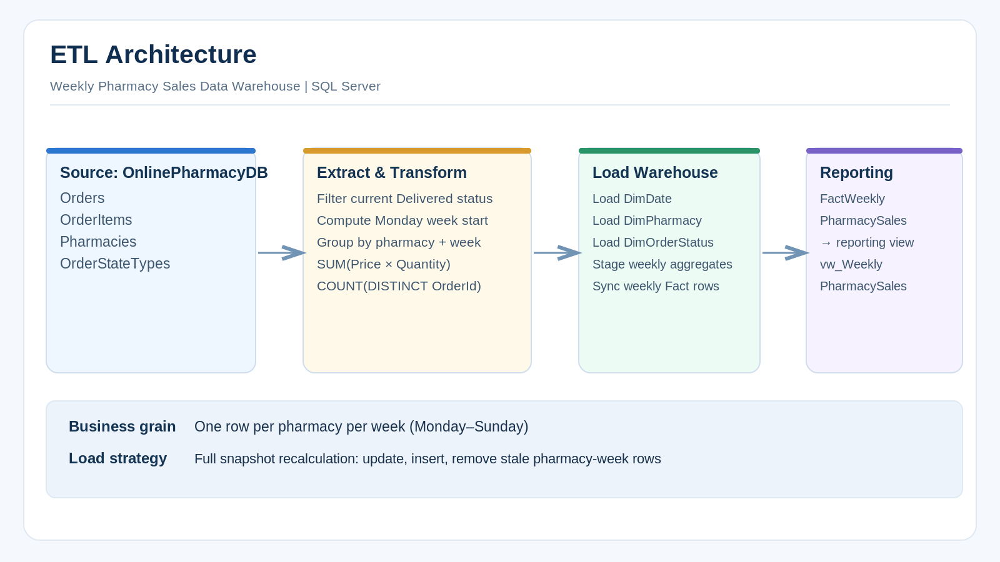
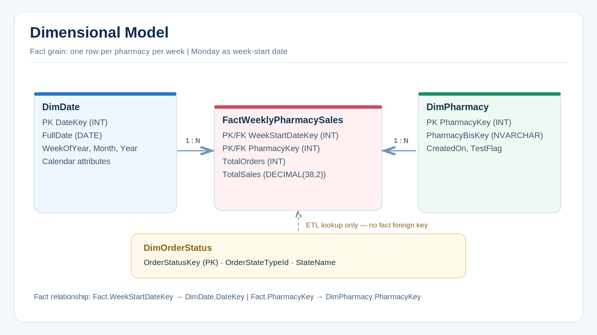
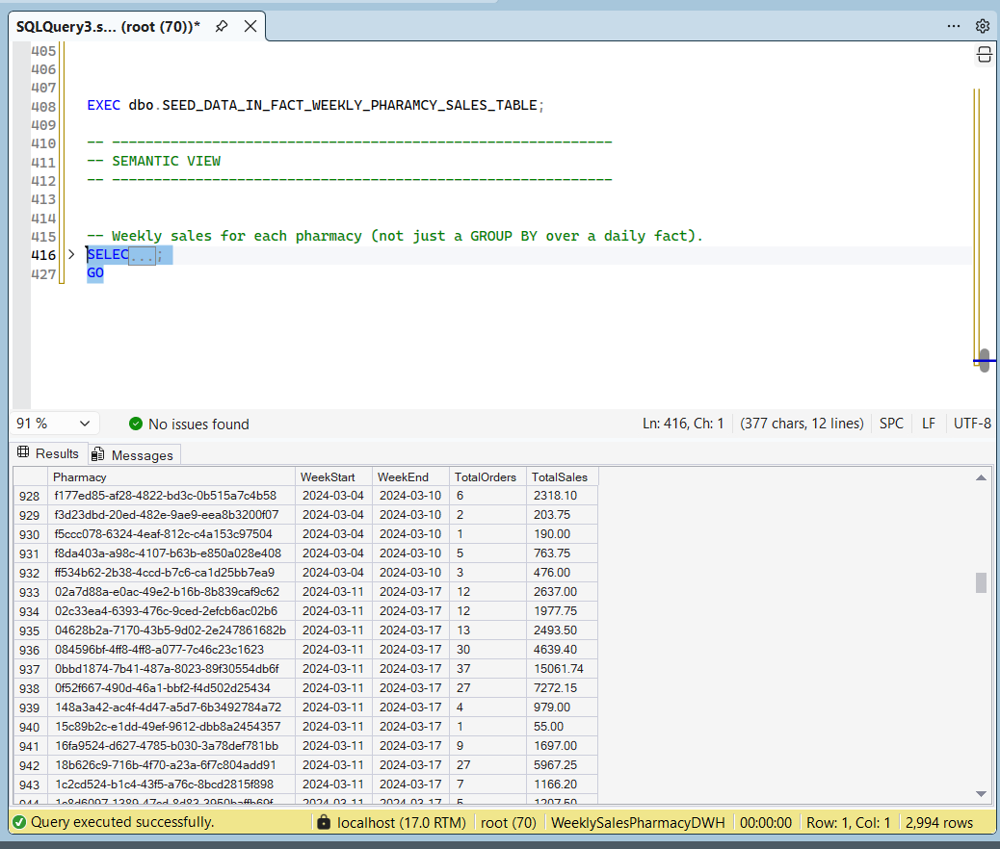

# Weekly Pharmacy Sales Data Warehouse

**A SQL Server Data Engineering project demonstrating dimensional modeling, ETL development, data quality validation, and weekly sales analytics.**

**Data Engineering Portfolio | Project 01**

## Overview

This project implements a SQL Server Data Warehouse that transforms transactional pharmacy orders into structured, analysis-ready data.

The solution extracts operational data from `OnlinePharmacyDB`, loads dimension tables, aggregates sales into a weekly fact table, and exposes a reporting view for pharmacy-level performance analysis.

### Business Problem

**How much did each pharmacy sell each week, and how many delivered orders contributed to those sales?**

Instead of repeatedly processing individual transactions for reporting, the warehouse stores pre-aggregated weekly sales metrics.

**Fact Grain:** One row per pharmacy per week.

Each reporting week starts on Monday and ends on Sunday.

## Technology Stack

| Technology | Purpose |
|---|---|
| Microsoft SQL Server | Data warehouse storage |
| T-SQL | Data transformation and aggregation |
| SQL Server Management Studio | SQL development and execution |
| Dimensional Modeling | Analytical schema design |
| Stored Procedures | ETL implementation |
| SQL Views | Reporting and data consumption |

## Data Architecture

The solution follows an Extract, Transform, Load (ETL) approach to move operational data into an analytical model.



The workflow consists of:

1. **Extract:** Retrieve orders, order items, pharmacies, and order statuses from `OnlinePharmacyDB`.
2. **Transform:** Filter delivered orders, calculate weekly reporting periods, resolve dimension keys, and aggregate sales metrics.
3. **Load:** Populate dimension tables and synchronize the weekly sales fact table.
4. **Report:** Expose the aggregated data through `vw_WeeklyPharmacySales`.

The ETL is implemented using SQL Server stored procedures.

## Dimensional Model

The warehouse uses a dimensional model centered on `FactWeeklyPharmacySales`.



### Data Warehouse Tables

| Table | Description |
|---|---|
| `DimDate` | Calendar dates and reporting attributes |
| `DimPharmacy` | Pharmacy identifiers and descriptive information |
| `DimOrderStatus` | Order status lookup used during ETL |
| `FactWeeklyPharmacySales` | Weekly revenue and delivered order counts per pharmacy |
| `vw_WeeklyPharmacySales` | Reporting view containing readable weekly sales metrics |

`DimOrderStatus` is used to identify delivered orders during ETL. It is not directly related to the fact table through a foreign key.

### Fact Table Design

**Fact Table:** `FactWeeklyPharmacySales`

**Grain:** One row per pharmacy per week.

| Column | Description |
|---|---|
| `WeekStartDateKey` | Foreign key referencing the Monday date in `DimDate` |
| `PharmacyKey` | Foreign key referencing `DimPharmacy` |
| `TotalOrders` | Number of distinct delivered orders |
| `TotalSales` | Total value of delivered order items |

The composite primary key is:

`(WeekStartDateKey, PharmacyKey)`

This ensures that each pharmacy has at most one fact record per reporting week.

### Metric Definitions

| Metric | Calculation |
|---|---|
| Total Sales | `SUM(Price * Quantity)` |
| Total Orders | `COUNT(DISTINCT OrderId)` |
| Week Start | Monday of the order creation week |
| Week End | Sunday of the same reporting week |

### Business Rules and Assumptions

- Only orders currently marked as `Delivered` are included.
- Sales are grouped using `Orders.CreatedOn`, not the actual delivery date.
- Each reporting week runs from Monday through Sunday.
- Orders with multiple items contribute to revenue for all their items but are counted once.
- Orders without order items are excluded.
- Delivery fees, refunds, discounts, and tax adjustments are not separately included unless reflected in item prices.
- No currency conversion is performed.
- Historical weekly totals may change when order statuses or item values change.
- Pharmacy-weeks without qualifying delivered order items are not stored.
- The reporting view excludes pharmacies marked as test records.

## ETL Pipeline Implementation

The ETL process uses stored procedures to load dimensions and maintain weekly sales aggregates.

### 1. Dimension Loading

The pipeline loads three dimensions:

- **DimDate:** Generates calendar records and date attributes.
- **DimPharmacy:** Synchronizes pharmacy information from the source database.
- **DimOrderStatus:** Loads order status reference data for identifying delivered orders.

Existing dimension records are updated when applicable, and new records are inserted.

### 2. Weekly Sales Transformation

The fact ETL performs the following operations:

- Filters orders with `Delivered` status.
- Calculates the Monday of each order's creation week.
- Resolves pharmacy and date dimension keys.
- Aggregates item-level sales into pharmacy-week totals.
- Counts distinct delivered orders.
- Stores the aggregated results in a temporary staging table.

### 3. Fact Table Loading

The staged weekly dataset is used to synchronize `FactWeeklyPharmacySales`.

The process:

- **UPDATE:** Refreshes existing pharmacy-week records when their metrics change.
- **INSERT:** Adds newly identified pharmacy-week records.
- **DELETE:** Removes outdated records that no longer have qualifying delivered orders.

The load operations use SQL transactions and error handling to reduce the risk of partially applied fact updates.

### Loading Strategy

**Full Snapshot Recalculation**

The current implementation recalculates the weekly aggregates from the operational source rather than relying on incremental Change Data Capture (CDC).

This approach supports re-runnable loads and simplifies handling of historical order changes.

It assumes that the complete source dataset is available and that ETL executions are run serially.

## Repository Structure

```text
weekly-pharmacy-sales-dwh/
│
├── README.md
├── .gitignore
│
├── docs/
│   └── images/
│       ├── etl-architecture.png
│       ├── star-schema.png
│       └── weekly-sales-results.png
│
├── sql/
│   ├── 01_schema.sql
│   ├── 02_load_dimensions.sql
│   ├── 03_load_fact.sql
│   ├── 04_semantic_view.sql
│   └── 05_run_etl.sql
│
└── tests/
    └── quality_checks.sql
```

## Getting Started

### Prerequisites

- Microsoft SQL Server 2016 SP1 or later, with support for the required T-SQL features.
- SQL Server Management Studio (SSMS) or `sqlcmd`.
- An existing source database named `OnlinePharmacyDB`.
- Permissions to create the Data Warehouse database and read the operational database.

### Required Source Tables

| Source Table | Required Columns |
|---|---|
| `Orders` | `Id`, `PharmacyKey`, `OrderStateTypeId`, `CreatedOn` |
| `OrderItems` | `OrderId`, `Price`, `Quantity` |
| `Pharmacies` | `Id`, `Key`, `CreatedOn`, `TestFlag` |
| `OrderStateTypes` | `Id`, `OrderStateTypeId`, `StateName` |

The operational database and business data are not included in this repository.

### Installation

**Step 1 — Clone the repository**

```bash
git clone https://github.com/seifhassan89/weekly-pharmacy-sales-dwh.git
cd weekly-pharmacy-sales-dwh
```

**Step 2 — Configure the environment**

Connect to the SQL Server instance containing `OnlinePharmacyDB`.

Verify that the source tables and columns match the expected schema.

**Step 3 — Execute the scripts**

Run the SQL scripts in the following order:

| Order | Script | Purpose |
|---|---|---|
| 1 | `sql/01_schema.sql` | Create database, dimensions, fact table, and constraints |
| 2 | `sql/02_load_dimensions.sql` | Create dimension loading procedures |
| 3 | `sql/03_load_fact.sql` | Create fact loading procedure |
| 4 | `sql/04_semantic_view.sql` | Create reporting view |
| 5 | `sql/05_run_etl.sql` | Execute the ETL procedures and display results |

**Step 4 — Validate the data**

Run:

`tests/quality_checks.sql`

Review the validation results and investigate any failures before relying on the reported metrics.

## Sample Query Results

The following screenshot shows weekly pharmacy sales data retrieved from SQL Server after executing the ETL.



The reporting output includes:

| Column | Description |
|---|---|
| `Pharmacy` | Pharmacy business identifier |
| `WeekStart` | First day of the reporting week |
| `WeekEnd` | Last day of the reporting week |
| `TotalOrders` | Distinct delivered order count |
| `TotalSales` | Aggregated sales value |

### Example Reporting Query

```sql
USE WeeklySalesPharmacyDWH;
GO

SELECT
    Pharmacy,
    WeekStart,
    WeekEnd,
    TotalOrders,
    TotalSales
FROM dbo.vw_WeeklyPharmacySales
ORDER BY
    WeekStart,
    Pharmacy;
```

This query reads from the reporting view rather than recalculating the underlying transactional sales.

## Data Quality and Validation

The project includes `tests/quality_checks.sql` to validate key warehouse properties.

### Implemented Checks

- Fact grain uniqueness.
- Pharmacy and date lookup uniqueness.
- Valid Monday week-start dates.
- Basic fact-to-dimension referential integrity.
- Basic fact measure consistency.

### Recommended Integration Test Scenarios

| Scenario | Expected Result |
|---|---|
| Order contains multiple items | Revenue includes all items; the order is counted once |
| ETL runs multiple times | No duplicated pharmacy-week records |
| Order item price changes | Weekly sales total is recalculated |
| New order becomes Delivered | Relevant weekly aggregate is updated or inserted |
| Last delivered order becomes ineligible | Outdated pharmacy-week fact is removed |

The included checks do not replace a full integration test against representative source data.

## Design Decisions and Trade-offs

### Source-Derived Dimension Keys

The pharmacy dimension uses integer identifiers derived from the source system.

This simplifies the implementation for an introductory project but does not provide independent, warehouse-generated surrogate identities.

### Monday-Based Weekly Grain

Reporting periods are identified using their actual Monday start dates rather than only week numbers.

This avoids ambiguity when analyzing weeks across calendar-year boundaries.

### Re-runnable ETL

The fact pipeline uses the current source data to recalculate weekly results.

This supports repeated executions and historical corrections, but reprocesses unchanged data.

### Calendar Coverage

The date dimension defaults to the period 2020–2030.

This range must be extended when processing source records outside the configured dates.

### Current Limitations

- No incremental CDC or watermark-based processing.
- No scheduled orchestration or pipeline monitoring.
- No currency normalization.
- No independent handling of delivery fees, refunds, or tax adjustments.
- No automated source-to-warehouse financial reconciliation.
- The full-snapshot load requires a complete and sufficiently consistent source dataset.

## Future Enhancements

Possible extensions to the project include:

- Incremental ETL using CDC or change tracking.
- Scheduled execution with SQL Server Agent or an orchestration platform.
- ETL execution logging and monitoring.
- Automated source-to-target reconciliation.
- Improved error handling and operational alerting.
- Additional analytical metrics and dimensions.
- Power BI dashboards for sales trends and pharmacy performance.

These features are future improvement opportunities, not part of the current implementation.

## Learning Outcomes

Through this project, I practiced foundational Data Engineering concepts, including:

- Data warehousing fundamentals
- Dimensional modeling and fact table grain
- Fact and dimension table relationships
- ETL pipeline design using T-SQL
- Business key and dimension key lookups
- Data aggregation and reporting
- Re-runnable data synchronization
- Data quality validation
- Technical documentation

## Project Information

**Project Type:** Data Engineering Course Assignment

**Portfolio:** Data Engineering — Project 01

**Database:** Microsoft SQL Server

**Author:** Seif Hassan

---

*This project was developed for educational purposes to demonstrate foundational Data Engineering practices. It is not intended to represent a production-hardened data platform.*